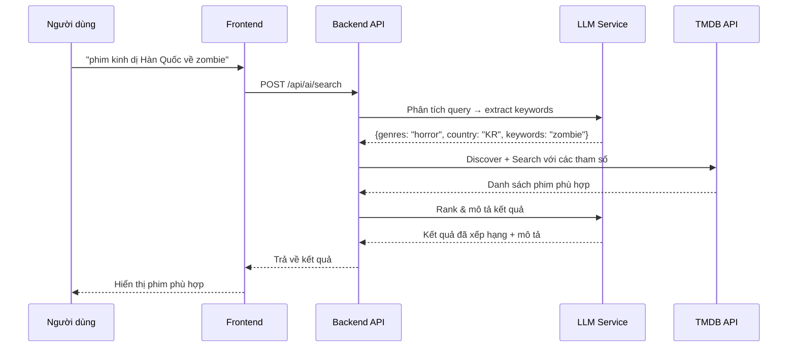
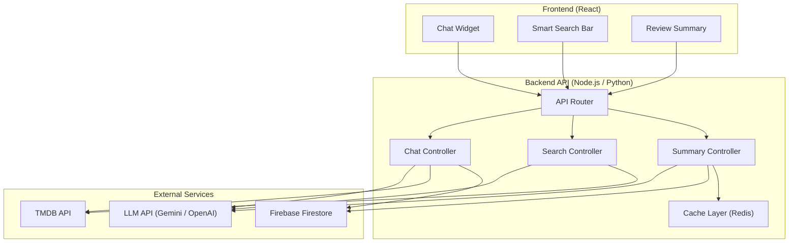

# Tích Hợp Mô Hình Ngôn Ngữ Lớn (LLM) — Website Đánh Giá Phim MovieReview

## 1. Tổng Quan

### 1.1. Mục tiêu
Tích hợp LLM vào website MovieReview nhằm nâng cao trải nghiệm người dùng thông qua:
- **Tìm kiếm thông minh**: Cho phép tìm phim bằng ngôn ngữ tự nhiên thay vì chỉ tìm theo tên
- **Tư vấn cá nhân hóa**: Gợi ý phim phù hợp với sở thích, tâm trạng, hoàn cảnh của người dùng
- **Tóm tắt & phân tích**: Tổng hợp đánh giá cộng đồng thành nhận xét ngắn gọn

### 1.2. Bài toán nghiệp vụ

| Vấn đề hiện tại | Giải pháp LLM |
|---|---|
| Tìm kiếm chỉ dựa vào **tên phim** (keyword matching) | Tìm kiếm bằng **mô tả nội dung**, ví dụ: *"phim kinh dị Hàn Quốc về zombie"* |
| Gợi ý phim chỉ dựa vào **thể loại/popularity** từ TMDB | Gợi ý dựa trên **ngữ cảnh cá nhân**: *"tôi buồn, muốn xem phim vui vẻ"* |
| Người dùng phải đọc **nhiều bình luận** để hiểu đánh giá chung | LLM **tóm tắt** bình luận thành 2-3 câu |
| Không có kênh **tương tác trực tiếp** | Chatbot AI hỗ trợ hỏi đáp về phim |

---

## 2. Các Tính Năng Đề Xuất

### 2.1. 🤖 Chatbot Tư Vấn Phim (AI Movie Advisor)

**Mô tả**: Một cửa sổ chat ngay trên website, người dùng có thể trò chuyện tự nhiên để được tư vấn phim.

**Ví dụ hội thoại**:
```
👤 User:  "Tối nay muốn xem phim với bạn gái, gợi ý cho mình phim lãng mạn 
           hay gần đây đi"
🤖 AI:    "Dưới đây là 3 gợi ý phim lãng mạn hot gần đây:
           1. 🎬 La La Land (2016) - ⭐ 8.0 - Câu chuyện tình yêu và đam mê 
              giữa một nhạc sĩ jazz và một nữ diễn viên tại Los Angeles
           2. 🎬 Past Lives (2023) - ⭐ 7.8 - Hai người bạn thời thơ ấu tái 
              ngộ sau 24 năm tại New York
           3. 🎬 The Notebook (2004) - ⭐ 7.8 - Kinh điển, phù hợp để xem 
              cùng người yêu
           
           Bạn muốn xem chi tiết phim nào?"

👤 User:  "Past Lives hay không? Có buồn không?"
🤖 AI:    "Past Lives được đánh giá rất cao. Phim có những khoảnh khắc xúc 
           động nhưng không quá buồn. Trên MovieReview, cộng đồng đánh giá 
           trung bình 8.2/10 với 15 lượt đánh giá. Bình luận nổi bật: 
           'Phim đẹp, nhẹ nhàng, rất đáng xem'."
```

**Các khả năng chính**:
- Gợi ý phim theo tâm trạng, thể loại, hoàn cảnh
- Trả lời câu hỏi về nội dung phim (không spoil)
- Đính kèm link đến trang chi tiết phim trên MovieReview
- So sánh hai bộ phim theo yêu cầu
- Gợi ý phim tương tự với phim người dùng thích

---

### 2.2. 🔍 Tìm Kiếm Ngữ Nghĩa (Semantic Search)

**Mô tả**: Nâng cấp thanh tìm kiếm hiện tại, cho phép tìm phim bằng mô tả nội dung thay vì chỉ tên phim.

**So sánh**:

| Tìm kiếm hiện tại (keyword) | Tìm kiếm LLM (semantic) |
|---|---|
| `"Inception"` → tìm đúng phim Inception | `"phim về giấc mơ trong giấc mơ"` → tìm ra Inception |
| `"zombie"` → tìm phim có "zombie" trong tên | `"phim về đại dịch biến người thành quái vật"` → Train to Busan, World War Z, 28 Days Later |
| Không tìm được nếu không nhớ tên | `"phim Leonardo DiCaprio đóng trên tàu Titanic"` → Titanic |

**Cách hoạt động**:



---

### 2.3. 📝 Tóm Tắt Đánh Giá Cộng Đồng (Review Summarizer)

**Mô tả**: Tự động tóm tắt tất cả bình luận của một bộ phim thành đoạn nhận xét ngắn gọn.

**Ví dụ**:

> **📊 Tóm tắt đánh giá cộng đồng** (từ 23 bình luận)
> 
> Phim được đánh giá **tích cực** với điểm trung bình **8.4/10**. Người xem đặc biệt khen ngợi **diễn xuất** của dàn diễn viên chính và **kỹ xảo hình ảnh** ấn tượng. Một số ý kiến cho rằng **cốt truyện hơi chậm** ở nửa đầu. Phim được khuyến nghị cho người thích thể loại khoa học viễn tưởng.

**Khi nào hiển thị**: Trên trang chi tiết phim, phía trên phần bình luận, chỉ hiện khi có ≥ 5 bình luận.

---

## 3. Kiến Trúc Hệ Thống

### 3.1. Tổng quan kiến trúc



### 3.2. Hai phương án triển khai

#### Phương án A: Gọi LLM API trực tiếp từ Frontend (Đơn giản)

```
React App → LLM API (Gemini/OpenAI) → Trả kết quả
```

> [!WARNING]
> - API Key bị lộ trên client → **rủi ro bảo mật cao**
> - Không kiểm soát được chi phí (người dùng spam)
> - Không cache được → tốn tiền

#### Phương án B: Qua Backend Proxy (Khuyến nghị) ⭐

```
React App → Backend API (Vercel Serverless) → LLM API → Trả kết quả
```

> [!TIP]
> - API Key an toàn trên server
> - Có thể rate-limit, cache, log
> - Kiểm soát chi phí hiệu quả
> - Dễ thay đổi LLM provider sau này

---

## 4. Lựa Chọn Công Nghệ

### 4.1. So sánh LLM Provider

| Tiêu chí | Google Gemini | OpenAI GPT | Groq (Llama) |
|---|---|---|---|
| **Free tier** | ✅ 15 RPM miễn phí (Gemini Flash) | ❌ Trả phí từ đầu | ✅ Free tier có giới hạn |
| **Giá (1M tokens)** | $0.075 (Flash) | $0.15 (GPT-4o-mini) | $0.05 (Llama 3.1) |
| **Tốc độ** | Nhanh | Trung bình | Rất nhanh |
| **Tiếng Việt** | Tốt | Rất tốt | Khá |
| **Dễ tích hợp** | Rất dễ | Rất dễ | Dễ |

> [!IMPORTANT]
> **Đề xuất**: Dùng **Google Gemini 2.0 Flash** vì:
> - Có **free tier** (15 requests/phút) — đủ cho demo/đồ án
> - Hỗ trợ tiếng Việt tốt
> - Tốc độ nhanh, giá rẻ khi scale
> - SDK JavaScript chính thức (`@google/generative-ai`)

### 4.2. Stack Backend

| Thành phần | Công nghệ | Lý do |
|---|---|---|
| **API Server** | Vercel Serverless Functions (Node.js) | Đã deploy trên Vercel, không cần server riêng |
| **LLM SDK** | `@google/generative-ai` | SDK chính thức của Google |
| **Cache** | Vercel KV (Redis) hoặc in-memory | Cache kết quả tóm tắt, giảm chi phí |
| **Rate Limiting** | Custom middleware | Giới hạn request/user/phút |

---

## 5. Chi Phí Ước Tính

### 5.1. Với Gemini Flash (Free Tier)

| Tính năng | Tokens/request | Requests/ngày | Chi phí |
|---|---|---|---|
| Chat tư vấn | ~1,000 | 50 | **$0** (free tier) |
| Tìm kiếm ngữ nghĩa | ~500 | 100 | **$0** (free tier) |
| Tóm tắt đánh giá | ~2,000 | 20 | **$0** (free tier) |
| **Tổng** | | **170 req/ngày** | **$0/tháng** |

> [!NOTE]
> Free tier của Gemini cho phép **15 requests/phút** và **1,500 requests/ngày**. Với quy mô đồ án, hoàn toàn đủ dùng miễn phí.

### 5.2. Khi scale (tham khảo)

| Quy mô | Requests/tháng | Chi phí ước tính |
|---|---|---|
| Demo/Đồ án | ~5,000 | **$0** |
| 100 users/ngày | ~50,000 | **~$3-5/tháng** |
| 1,000 users/ngày | ~500,000 | **~$30-50/tháng** |

---

## 6. Thiết Kế API

### 6.1. Endpoints

```
POST /api/ai/chat          — Chatbot tư vấn phim
POST /api/ai/search        — Tìm kiếm ngữ nghĩa  
GET  /api/ai/summary/:id   — Tóm tắt đánh giá phim
```

### 6.2. Chi tiết API

#### `POST /api/ai/chat` — Chatbot tư vấn

```json
// Request
{
  "message": "gợi ý phim kinh dị hay để xem Halloween",
  "history": [
    { "role": "user", "content": "tôi thích phim kinh dị" },
    { "role": "assistant", "content": "Bạn thích kinh dị kiểu nào?..." }
  ]
}

// Response
{
  "reply": "Đây là 3 phim kinh dị hay cho Halloween:\n1. 🎬 **The Conjuring**...",
  "movies": [
    { "id": 138843, "title": "The Conjuring", "mediaType": "movie" },
    { "id": 493922, "title": "Hereditary", "mediaType": "movie" }
  ]
}
```

#### `POST /api/ai/search` — Tìm kiếm thông minh

```json
// Request
{
  "query": "phim về robot có cảm xúc như con người"
}

// Response
{
  "results": [
    {
      "id": 72105,
      "title": "Her",
      "mediaType": "movie",
      "relevance": "AI phát triển cảm xúc giống con người",
      "score": 0.95
    }
  ],
  "interpretation": "Bạn đang tìm phim về trí tuệ nhân tạo/robot có cảm xúc..."
}
```

#### `GET /api/ai/summary/movie/550` — Tóm tắt đánh giá

```json
// Response
{
  "mediaId": 550,
  "mediaType": "movie",
  "commentCount": 23,
  "summary": "Phim được đánh giá tích cực với điểm trung bình 8.4/10...",
  "sentiment": "positive",
  "highlights": ["diễn xuất tuyệt vời", "kỹ xảo ấn tượng"],
  "concerns": ["nhịp phim chậm ở nửa đầu"],
  "cachedAt": "2026-09-10T10:00:00Z"
}
```

---

## 7. Thiết Kế Prompt (System Prompt)

### 7.1. Chatbot Tư Vấn

```
Bạn là trợ lý AI tư vấn phim trên website MovieReview. 

Nhiệm vụ:
- Gợi ý phim phù hợp với yêu cầu của người dùng
- Trả lời câu hỏi về nội dung phim (KHÔNG spoil cốt truyện)
- So sánh phim khi được yêu cầu
- Luôn đề xuất 2-5 phim, kèm tên gốc, năm, điểm TMDB, và mô tả ngắn 1-2 câu

Quy tắc:
- Trả lời bằng tiếng Việt
- Sử dụng emoji phù hợp (🎬⭐🔥)
- Khi gợi ý phim, luôn kèm ID phim từ TMDB để frontend có thể tạo link
- Nếu không chắc chắn, hãy hỏi lại người dùng
- Không trả lời các câu hỏi không liên quan đến phim/giải trí
```

### 7.2. Tóm Tắt Đánh Giá

```
Tóm tắt các bình luận sau đây về một bộ phim thành 2-3 câu tiếng Việt.

Yêu cầu:
- Nêu xu hướng đánh giá chung (tích cực/tiêu cực/trung lập)
- Liệt kê 2-3 điểm được khen nhiều nhất
- Liệt kê 1-2 điểm bị chê (nếu có)
- Đưa ra khuyến nghị xem phim cho ai

Bình luận:
{comments}
```

---

## 8. Thiết Kế UI

### 8.1. Chat Widget

```
┌──────────────────────────────────────┐
│  🤖 AI Movie Advisor          [─] [×] │
├──────────────────────────────────────┤
│                                        │
│  🤖 Xin chào! Tôi có thể giúp bạn    │
│     tìm phim phù hợp. Hãy cho tôi    │
│     biết bạn muốn xem gì!             │
│                                        │
│  👤 Muốn xem phim vui vẻ cùng gia    │
│     đình                               │
│                                        │
│  🤖 Đây là 3 gợi ý:                  │
│     1. 🎬 Coco (2017) - ⭐ 8.4       │
│        [Xem chi tiết →]               │
│     2. 🎬 Inside Out 2 - ⭐ 7.6      │
│        [Xem chi tiết →]               │
│     3. 🎬 Luca (2021) - ⭐ 7.5       │
│        [Xem chi tiết →]               │
│                                        │
├──────────────────────────────────────┤
│  [💬 Nhập tin nhắn...        ] [Gửi] │
└──────────────────────────────────────┘
```

### 8.2. Smart Search (nâng cấp thanh tìm kiếm)

```
┌─────────────────────────────────────────┐
│ 🔍 phim về hacker chống lại tập đoàn   │
├─────────────────────────────────────────┤
│ 🧠 AI hiểu: phim về hacker, công nghệ  │
│                                          │
│ 🎬 Mr. Robot (TV) - ⭐ 8.5             │
│    "Hacker chống tập đoàn tài chính"    │
│                                          │
│ 🎬 The Matrix (1999) - ⭐ 8.7          │
│    "Cuộc chiến chống hệ thống máy tính" │
│                                          │
│ 🎬 Who Am I (2014) - ⭐ 7.5            │
│    "Nhóm hacker Đức nổi tiếng thế giới" │
└─────────────────────────────────────────┘
```

### 8.3. Review Summary (trên trang chi tiết phim)

```
┌─────────────────────────────────────────┐
│ 📊 Tóm tắt đánh giá AI (23 bình luận) │
├─────────────────────────────────────────┤
│                                          │
│ Phim được đánh giá tích cực ✅ với      │
│ điểm trung bình 8.4/10.                 │
│                                          │
│ 👍 Điểm mạnh: diễn xuất, kỹ xảo,      │
│    nhạc phim                             │
│ 👎 Hạn chế: nhịp phim chậm ở nửa đầu  │
│                                          │
│ 💡 Phù hợp cho: fan thể loại sci-fi,   │
│    thích phim sâu sắc                    │
│                                          │
│ Được tạo bởi AI · Cập nhật 2 giờ trước │
└─────────────────────────────────────────┘
```

---

## 9. Kế Hoạch Triển Khai

### Phase 1: Chatbot Tư Vấn (ưu tiên cao nhất)
- Tạo Vercel Serverless API (`/api/ai/chat`)
- Tích hợp Gemini SDK
- Xây component `ChatWidget.jsx`
- System prompt + function calling với TMDB
- **Thời gian**: ~2-3 ngày

### Phase 2: Tìm Kiếm Ngữ Nghĩa
- API endpoint `/api/ai/search`
- Nâng cấp `Navbar` search bar
- Component `SmartSearchResults.jsx`
- **Thời gian**: ~1-2 ngày

### Phase 3: Tóm Tắt Đánh Giá
- API endpoint `/api/ai/summary/:mediaType/:id`
- Component `ReviewSummary.jsx` trên `MovieDetailPage`
- Cache kết quả (tránh gọi lại mỗi lần)
- **Thời gian**: ~1 ngày

---

## 10. Câu Hỏi Cần Quyết Định

> [!IMPORTANT]
> 1. **Chọn LLM nào?** Đề xuất Gemini Flash (miễn phí), hoặc bạn có preference khác?
> 2. **Triển khai tính năng nào trước?** Chatbot? Tìm kiếm? Tóm tắt? Hay cả 3?
> 3. **Backend**: Dùng Vercel Serverless Functions (Node.js) hay tạo backend riêng?
> 4. **Có muốn giới hạn tính năng AI cho user đã đăng nhập không?**
